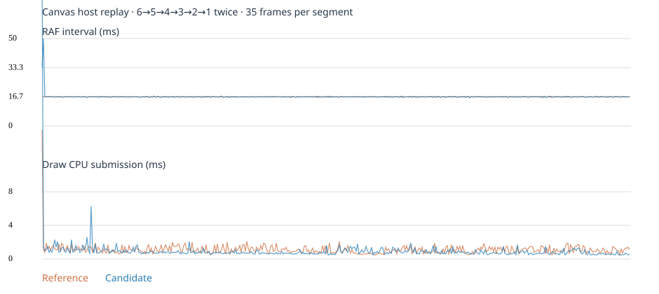

# 전투 조작·복귀·가시성 통합 검증

기준은 실제 main `4a9ee7574a82af9f18f62de4e50a36de2d5142ae`다. 사용자 기기의 오류 로그는 제공되지 않았다. 아래 원인은 저장소와 격리 시험에서 확인한 경로다.

| 항목 | 원인과 변경 파일 | 확인한 결과와 범위 |
|---|---|---|
| B01 이동 | `controls.js`의 지역 포인터가 reset 후에도 남았고, 이동키가 아닌 키도 스틱 벡터를 덮었다. 포인터 소유권을 controls에 두고 중립화할 때 캡처·노브·키·배치를 함께 정리한다. | Chromium CDP 멀티터치에서 이동+공격, cancel, 새 터치, 포커스·증강 창 이후 실제 이동 확인. 실물 터치 기기는 미검증. |
| B02 평타·스킬 | 입력 번호 역행과 오래된 연결의 요청 재시도, 스킬 재시전 상태가 평타 쿨타임에도 적용되는 클라이언트 조건을 수정했다. `controls.js`, `connection.js`, engine `index.js`. | 높은 번호로 실제 발동 후 복귀한 학생이 다시 입력했다. 엔진의 firedAttack/firedSkill 증가와 공격자·상대·호스트의 실제 draw에서 해당 actionSeq를 확인했다. |
| B03 전투 시작·오류 | Pixi 초기화/컨텍스트 손실 후 이미 WebGL에 묶인 canvas를 2D로 쓰는 경로와 draw 예외가 RAF를 영구 중단하는 경로를 수정했다. `renderer.js`, `ui/app.js`, 서버 `runner.js`, `room.js`. | 실제 WebGL loss → 새 Canvas로 같은 경기 계속. 주입한 Canvas draw 오류 → 복원 버튼/RESYNC. 주입한 서버 simulation 오류 → 연결된 호스트가 안내를 보고 결과 화면으로 종료 → 새 경기에서 서버 틱 재개. 기존에는 REMATCH가 이전 경기의 safePaused/lastFault를 유지했다. 사용자가 겪은 모든 튕김의 원인은 특정되지 않았다. |
| B04 재접속 | FULL_STATE가 controls 카운터를 0으로 만들고 서버는 기존 수신 번호를 유지했다. `ws/handler.js`, engine `index.js`, `connection.js`, `controls.js`, `ui/app.js`에서 실제 수신/처리 기준과 현재 공개 snapshot을 복귀자에게 전달한다. | 원본 실험에서 서버 적용 번호 100005, 새로고침한 클라이언트 48, 이동키를 눌러도 적용 번호 100005. 패치는 같은 playerId·생명·HP 상태로 첫 이동을 적용하고 평타·스킬이 다시 발동했다. 실제 연결 종료, offline/online, 이전 소켓의 지연 콜백, 자동 재시도 종료 후 버튼 복귀 확인. |
| B05 출발점·잔상 | 궤도탄의 spawn fallback이 과거 위치를 재사용하고, nullable target-strike 좌표를 숫자 0으로 변환했으며, transit 끝점을 원래 cast origin으로 대체할 수 있었다. `timeline.js`, `flight.js`, `original-painters.js`, `rework-core.js`. | 권위 snapshot으로 인계된 뒤 시야에서 빠진 탄은 spawn으로 부활하지 않는다. painter 명령에서 null→월드 원점 연결 제거와 유효 terminal 구간 보존을 검증했다. 궤도 수명 종료 후 세 화면 모두에서 제거됐다. 실제 사용자 영상의 선을 단일 원인으로 확정하지 않았다. |
| B06 회오리·투사체 | engine `nativeShot`의 궤도탄 start가 snapshot마다 현재 틱으로 바뀌어 뒤쪽 렌더 시계가 생성 전으로 판단했다. | 원본의 동일 탄에서 start가 5→13으로 매 틱 바뀌는 것을 기록했다. 수정 후 실제 학생 UI로 발동한 회오리 3개를 공격자·상대·호스트에서 확인했다. Canvas/Pixi 각각 low/balanced/high에서 같은 프레임의 본체 유무에 따른 해당 영역 픽셀 차이를 검사한다. |
| B07 위치 조준 | 제스처 power가 기존 cue에 전달되지 않고 마우스 방향이 화면 정중앙 기준이었다. `aim-guide.js`, `renderer.js`, `controls.js`, `previews.js`. | 서버 원본 brAimSpec의 거리·범위와 보정치를 사용한다. 실제 드래그, 화면 회전, 벽/경계에서 착지·중력장·기관차·도약 목표를 권위 결과와 비교했다. 로컬 최대 차이는 0.17 월드 단위 미만. 움직이는 대상과 학생에게 숨겨진 대상은 발동 순간 서버가 최종 판정한다. |
| B08 평타 조준 | 기존 cast cue 일부는 총구/선딜만 표시해 조준 방향·폭·부채꼴을 읽기 어려웠다. 개인 foreground에 실제 공격 spec의 방향과 범위를 그린다. | 전체 현재 roster의 평타/스킬 spec을 최소·중간·최대 power에서 검증했다. 실제 평타 드래그와 취소 후 표시 제거를 Canvas/Pixi에서 확인했다. |
| B09 최후 5인 | Canvas 최종 광원·링·텍스트를 매 프레임 재생성하고 HUD feed가 매 snapshot DOM을 새로 만들었다. `host-canvas.js`, `renderer.js`, `camera.js`, `app.js`. 광원과 이름을 캐시하고, 카메라는 기존 60fps 보간량을 기준으로 경과 시간을 사용한다. | 아래 동일 장면에서 그리기 비용이 감소했다. 원본에서 사용자가 보고한 긴 프레임이 재현되지 않아 실기기 끊김 해소는 **미확인**이다. |
| B10 움직임·기존 기능 | 같은 엔진 snapshot을 이전/수정 Timeline에 재생했다. | 정지 위치 폭 0, 원격 최대 이동 5.2054, 직선 탄 최대 이동 27.84, 첫 자기 이동 4틱으로 양쪽이 같았다. 세 모드·BGM·HUD·퀴즈 시계·시상·재경기는 기존 Quick/Targeted와 짧은 음향 시험으로 검사한다. |

**T01~T11 실행 경로**

| 시험 | 증거 |
|---|---|
| T01·T02 | `tests/combat/session.mjs` — 독립 브라우저 3개, Chromium touchStart/move/cancel/end, 방향키, Space/Q, focus, 증강 닫기·선택, 오버레이 후 재이동 |
| T03 | `tests/unit/combat-recovery.test.mjs` — stun 유지/종료, dash 종료, channel 중단, capture 소유자 정리. 실제 벽 충돌 후 돌진 끝점은 aim 시험에서 별도로 검증 |
| T04·T05 | session — 새로고침, 네트워크 offline+서버 소켓 terminate, 같은 학생 복귀, 오래된 소켓 이벤트 무시, 수동 복귀, 실제 이동과 양쪽 공격. 종료된 방이나 새 프로세스가 토큰으로 방을 새로 만들지 않음 |
| T06·T07 | session의 세 화면 픽셀, `origin-contract.mjs`, 기존 flight/prediction 단위 시험. 기존 all77 실행기의 판정을 유지한 채 RW 궤도·설치·귀환·유도·채널 대표 5종만 각 renderer에서 추가 실행 |
| T08 | `tests/combat/aim.mjs` — 브라우저 버튼 드래그 → 서버 입력 큐 → 실제 엔티티/돌진 종료 위치 비교. 390×844 및 844×390 |
| T09 | `tests/integration/combat-resume.test.mjs` — 기절/사망/부활 퀴즈 상태에서 원시 WS 10회 교체. 기존 부활 정답·재생성 검사와 session의 실제 재경기 |
| T10 | `late-host.mjs`, `perf-report.mjs` — 원본 checkout과 수정 checkout에서 동일 fixture를 재생. 6→5→4→3→2→1 두 차례. 저수준 수치는 실측이며 GPU 시간을 역산하지 않았다. |
| T11 | `tests/e2e/game.spec.js` 세 모드 및 `tests/releaseops/audio.mjs`, 기존 퀴즈 deadline·snapshot·mode parity. 실제 스피커 청취는 미실행. |

**호스트 비교** — 1366×768, Edge headless/Canvas 소프트웨어 래스터, 동일한 공개 snapshot을 loopback WS로 전달. 36개 탄·160개 파티클·12개 링·16개 텍스트를 포함한다. 5인 이하 구간당 합계 350프레임이다. snapshot 간격은 각 구간에서 수집한 최근 표본으로 창이 겹칠 수 있다. recorded scene 시험이므로 실제 30명 서버 tick/overload 측정은 아니다.

| 지표 | 기준 | 수정 |
|---|---:|---:|
| RAF p50/p95/p99 ms | 16.7 / 16.9 / 17.0 | 16.7 / 17.0 / 17.0 |
| 33.3ms / 50ms 초과 | 0 / 0 | 0 / 0 |
| draw CPU p50/p95/p99 ms | 1.0 / 1.7 / 2.0 | 0.7 / 1.4 / 1.9 |
| snapshot 수신 p95 ms | 74.0 | 68.4 |
| 그라디언트 생성 / 주 canvas 텍스트 호출 | 1400 / 6650 | 350 / 5600 |

별도 실시간 6→1 실험에서는 같은 seed와 입력 주기로 학생·호스트를 WebSocket에 연결했다. 양쪽 모두 생존 1명에서 결과로 전환했다. 서버 step p95는 기존 11.81ms, 패치 12.89ms였고 snapshot 간격 p95는 65.31ms와 68.59ms였다. 서버 overload는 양쪽 모두 0회였다. 이 실험에서 서버 처리 시간 개선은 관측되지 않았다.

[전체 계측 요약](evidence/combat/host-summary.json) · [공격자](evidence/combat/pixi-attacker.png) · [상대](evidence/combat/pixi-opponent.png) · [호스트](evidence/combat/pixi-host.png) · [조준](evidence/combat/aim-pixi.png)

**검사 시간과 제한.** 개발 중 로컬 combat 묶음은 Canvas 45.45초, Pixi 42.36초였고, 5개 연결·계약 검사는 약 0.4초였다. 실제 최종 SHA의 CI 시간과 판정은 PR에 별도 기록한다. 초기 시험의 쿨타임 대기 한 번은 제한 시간 안에 끝나지 않았다. 재실행에서 통과했지만 그 첫 대기의 원인은 확정하지 않았다. 연속 증강 제안과 기관차 선딜 marker를 잘못 읽었던 fixture는 서버 제안 ID 교체와 실제 돌진 종료 위치를 확인하도록 수정했다.

첫 GitHub Pixi 세션은 짧은 평타의 세 화면 관측 대기에서 시간 초과했다. 두 번째 키 입력과 9개 렌더 샘플 뒤에 평타를 확인하던 시험을 바꿨다. 각 입력을 실제 WebSocket으로 큐에 넣은 뒤 권위 엔진의 6틱을 진행해 세 화면의 draw를 확인하고 그다음 공격을 입력한다. 동일 평타·스킬 번호, 픽셀, 쿨타임 검사를 유지했다. 수정된 로컬 Pixi 세션 31.52초 PASS.

명시적 탈퇴·강퇴·만료·버전 오류·다른 탭의 세션 인계는 복귀와 구분한다. 토큰은 sessionStorage에만 보관하며 탭 종료/브라우저 재실행 후 복귀는 보장하지 않는다. 경기 수치·쿨타임·잠금·서버 권위·buildId 매칭·60/20Hz를 유지한다.

**NOT_RUN** — 실제 교실/모바일 OS, 사용자 기기의 GPU/네트워크, 26/30명 600초, 462개 전수 시각 조합, 9,000프레임 Deep Audit, AWS/Pages/Firebase 배포. 공개 AWS 서버 및 클라이언트가 보고한 기존 buildId는 `206aaee4bca23d639769134bc86773fb3214ec1e`였다. 이 PR 검증용 공개 주소는 없다.
