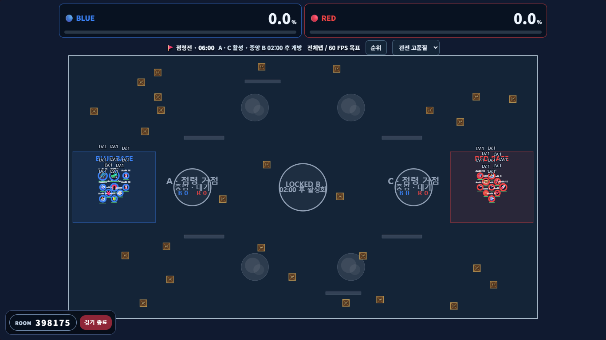
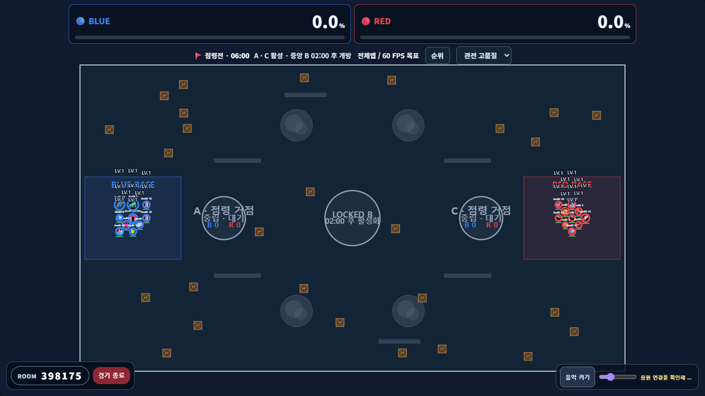
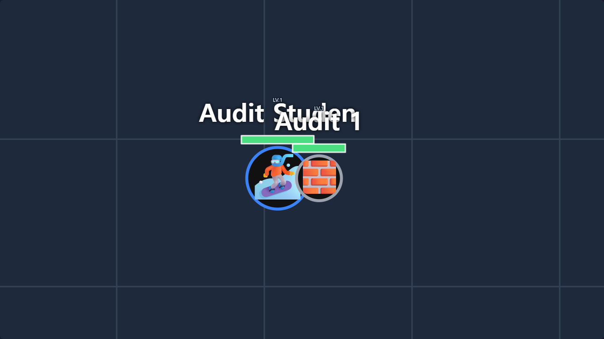
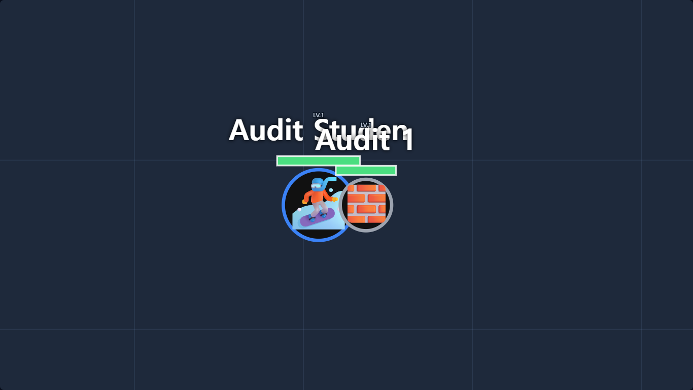
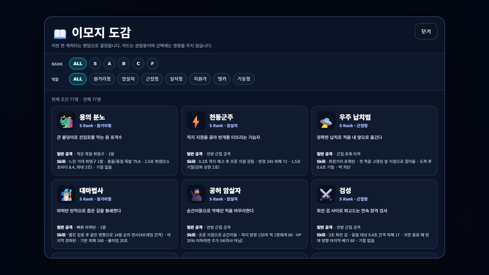
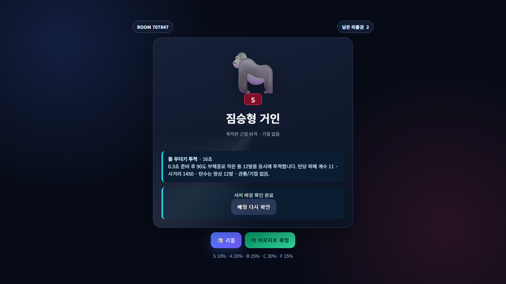
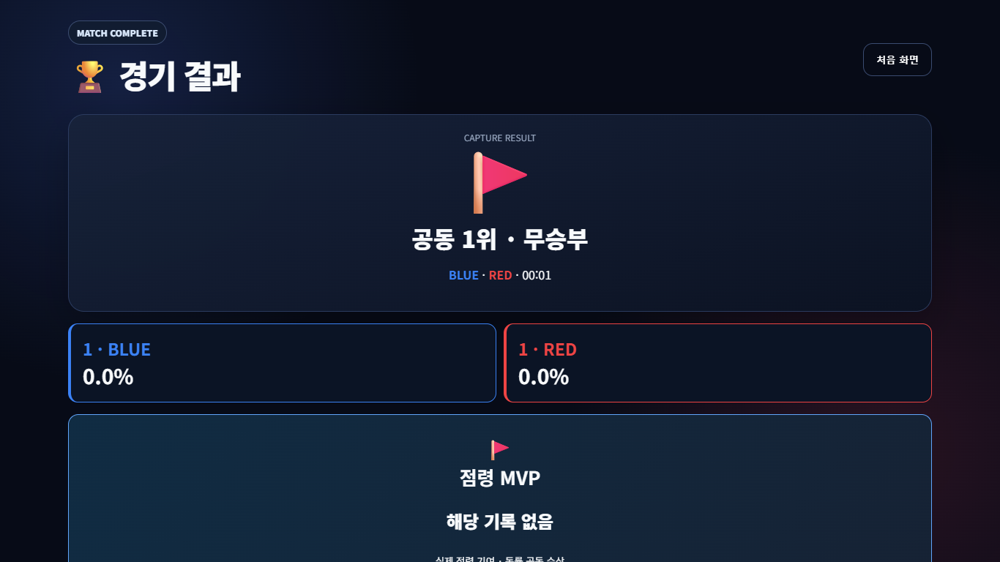
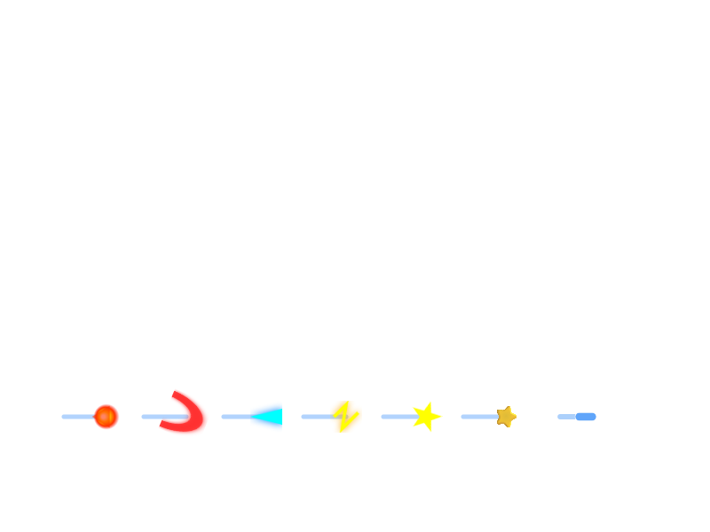

# v33.2 Full Fidelity Audit — executed evidence

작업 브랜치: `codex/v33-2-full-fidelity-audit`. 기준 main `9619942fb55eb5a96c9d6fea69f76fc99d12bbf0`. 최초 inventory를 구현 전에 커밋했다(로컬 `32d4a69`, 동일 tree의 GitHub 커밋 `6bb5edb9f46066b81a69e26ab8b6c9814cc0e740`). 구현 커밋은 GitHub `e95b2f632c1f9f1c30ff9e727ac050bfbca01c96`이며 로컬 `2b19b83a78f136cce2a73ec351dc2b16a5a9f6ad`와 tree `91eddc520a206a0f632b61e0f23777c1cda0ca42`가 정확히 일치한다. Git CLI 인증은 없어 GitHub 앱의 Git Data API로 작업 브랜치에 반영했다. force/main 갱신은 하지 않았다.

원본 root/legacy HTML은 변경하지 않았다. SHA-256 `a006aa596c5640ffe127774f271fce7afce81a4769525979fa453f9107ac5d36`, blob `4e6845b4565170ee2c84e75c0eee5dcc4f98ceac`. 전투/성장/모드 구현과 기존 content manifest는 그대로다. 서버 표시 스냅샷 및 배정 복구·로비 표시 계약만 확장했다. paired build sourceHash는 `2e934e06ac96664964d38148039d1af0408f7c01052f416613cbae0e389531b8`, buildId는 `v33-2e934e06ac966649`이다.

## 발견하고 복구한 차이

- 교사 전체맵 고정/최고킬 추적을 원본 인원별 bbox·padding·easing·첫 human 집중으로 복구했다. capture는 원본 전체 경계와 상단126/하단48/좌우24 여백을 유지하며 집중 토글이 동작하지 않는다.
- 원본 Canvas/Pixi의 서로 다른 HP/이름표/몸체·최종 광원·성능 모드 actor 표현, Canvas 입자/충격파/시그니처/피해문자, native 화염구·검기 등 7 texture 경로, 장판 메타데이터·포탑·연막·벽·드롭·사망750ms를 실제 렌더 경로로 연결했다. hostEffects는 학생에게 전송하지 않는다.
- 학생 카메라 look-ahead/easing, 원본 효과별 수명, 자기장 경고/테두리/비네트, 점령장판·경합 arc·지도 문자·내 점령 기여·stale 안내를 복원했다. 기존 증강 effect/detail, 비활성 stun=0, ordinal 인계는 회귀검사로 유지했다.
- 퀴즈 span을 지우던 UI를 수정하고 교사 시계/원형 진행률을 복구했다. 원래 정답320ms/오답1500ms 피드백을 서버 응답과 연결했다. 같은 match/end deadline은 재접속/재렌더로 늘어나지 않는다.
- 원본 음악 URL·역할별 기본값(host ON25/student OFF15)·ready/start/final·ended·fade·제스처·오류 안내를 연결했다. 묵살된 play reject를 진단하며, 일반 pointer/focus가 음악 버튼의 복구 클릭을 가로채던 문제도 고쳤다.
- 로비 단계/설명/출결/팀 선택·균형 요약, TXT 유효 행/오류 프리뷰, 77종 배정 설명/도감, 원본 결과/시상/순위 DOM을 복구했다. 학생/교사 배정 복구는 서버가 유효 배정을 그대로 재전송하고 손상된 값만 동일 난수 순서로 복원한다.
- 재경기 ACK의 새 matchId를 이전 scope 필터가 버리던 오류를 수정했다. 본인이 보낸 현재 경기의 pending REMATCH ACK만 예외로 허용한다.

## 시험별 실행 상태

자동시험은 Windows / Node24.22.1 / headless Microsoft Edge, 실제 loopback WebSocket을 사용했다. 기존 원본은 외부 요청을 모두 차단한 별도 브라우저에서 실행했다. Firebase 읽기/쓰기나 AWS 연결은 없다. 모든 이름은 테스트 픽스처다.

| ID | 시험 | 실행 결과와 한계 |
|---|---|---|
| T1 | `node tools/verify.mjs` | PASS 130/130(기존123 유지+7), 경계 검사 및 client/server build. legacy/content/combat 수치 원본 parity 포함 |
| E | `npm run test:e2e` | PASS 3모드 실제 브라우저 퀴즈→배정→전투→결과→재경기 |
| T2 | `npm run test:fidelity` 및 `FIDELITY_RENDERER=pixi node tests/fidelity/visuals.mjs` | PASS. 63증강,5/MAX,무스턴10초,30/60tick스턴,가상30/60/120FPS,가상2접점,13종 own/opponent Canvas/Pixi,원본 학생 HUD/화살표 비교 |
| L | `node tests/fidelity-v33-2/lobby.mjs` | PASS. 홈/로비4viewport,3모드 설정,10:10팀,TXT 부분 오류+54문제,실제 학생/교사 배정 복구. QR canvas/URL만 검사, 실제 스캔 미실행 |
| C | `node tests/fidelity-v33-2/camera.mjs` | PASS 9000프레임: 2backend×3viewport×5정책×5인원단계×60프레임. 비교 fixture 제약은 아래 참조 |
| H | `node tests/fidelity-v33-2/layout.mjs` | PASS 2backend×3모드×5viewport(1920/1366/1024/390/844). 실제 WS 교사/학생 캡처, HUD bounds, 점령 점수/music 비중첩, 순위 popup/화질30FPS 설정 |
| Q | `node tests/fidelity-v33-2/quiz.mjs` | PASS 교사+20WS,45/60/90초 각각45503/60641/90943ms 내 관측 종료. 1초 polling 포함. 학생1+교사1은 실제 브라우저,나머지19는 WS클라이언트. 전원 DRAFT. 재접속/숨김복귀 마감 유지 |
| M | `node tests/fidelity-v33-2/audio.mjs` | PASS 실제 Dropbox302→206 audio/mpeg, ready/start/final readyState4/currentTime 증가, 실제 ended→final, mute/volume/fade/rematch. NotAllowedError와503은 의도적 주입 시험. 하드웨어 청취/Safari/Firefox는 미검증 |
| D | `node tests/fidelity-v33-2/surface.mjs` | PASS 77 도감/77 draft 서버 데이터→원본 정확 DOM,4viewport 캡처 |
| R | `node tests/fidelity-v33-2/screens.mjs` | PASS 3모드 실제 서버 결과의 우승/시상/순위 DOM 정확 일치,4viewport,모드별5회 총15 rematch; 카메라/스턴/스프라이트/입력/pending/music 초기화 |
| V | `node tests/fidelity-v33-2/all77.mjs` | PASS 462조합. 77×low/balanced/high×Canvas/Pixi 실제 WS 공격/스킬과 렌더 호출. 아래 제한 필독 |
| F | `node tests/fidelity-v33-2/host-effects.mjs` | PASS 실제 host WS particle/ring/signature 원본 raster 비교,7종 native host texture/style pixel 일치,student에 hostEffects 없음 |
| P | `node tools/load/run.mjs --players=20 --seconds=600 --browser=true --recoverOverload=true` | PASS 기능/수명 계측: 600008ms,7라운드,239440 수신 snapshot,오류0,overload0,cleanup rooms/tokens/peers=0. 성능 수치는 아래 표; 학교 수용량 보장 아님 |
| FIELD | 동일 학교 Wi-Fi / 교사1+학생20 실기기 | UNVERIFIED. 실제 모바일 터치,스피커,프로젝터,OS 백그라운드 복구 미실행 |

테스트를 삭제하거나 피해 수치 검사만으로 화면 PASS를 판정하지 않았다. 기존 70개 인수 문서의 PASS28/PARTIAL39/FAIL1/NOT_RUN2 기록을 일괄 승격하지 않는다. 기존 26/30명600초의 overload pause 7/39회 실패도 그대로 남아 있으며 이번 결과로 해결을 주장하지 않는다.

### 20명 600초 실제 WS + 학생 Pixi 브라우저 결과

2026-11-03 04:12:26–04:22:30 UTC 실행. [전체 5초 간격 계측](fidelity-v33-2-evidence/load-20-600.json), [요약 로그](fidelity-v33-2-evidence/load-20-600.txt).

| 구분 | 측정값 |
|---|---|
| 서버 physics | 35994 step / 600.008초, 약59.99Hz |
| 서버 snapshot 생성 | 11972회, 약19.95Hz; gap 평균50.09ms / p95 62.62ms / 최대224.66ms |
| 서버 step CPU | 평균1.36ms / p95 3.04ms / p99 4.11ms / 최대50.51ms |
| 서버 snapshot CPU | 평균5.20ms / p95 7.52ms / 최대100.37ms |
| 실제 학생 browser RAF | 35785프레임; 최근1800 p95 16.8ms |
| 실제 학생 browser RTT | 300표본 p95 11.7ms (합성WS RTT p95 9.10ms와 분리) |
| 실제 학생 수신 gap | p95 61.4ms / 최대121.2ms (최근1200표본) |
| 위치 보정 | 최근1201표본 p95 10.74 world units / 최대206.79; holdFrames7 |
| 서버 메모리 | RSS 최초5초112353280B → 종료239349760B / 최대246685696B; 종료 heapUsed39246216B |
| 실제 학생 메모리 | 종료 browser JS heap140545251B; 캐시 texture17/sprite31/label21 |
| 서버 송신량 | 합계5875365998B/600초, 약78.34Mbit/s 전체 연결 합산(loopback); 실제 학교 대역폭 검증 필요 |
| 투사체 계측 | shotFrames34863 / emptyShotFrames922 / disappearedWithoutEnd1416. 수명·interest·인계가 섞인 관측값으로 끊김 PASS 판정하지 않음 |
| 오류 / 과부하 / 정리 | browser error0,명령 오류0,overload pause0; 방/토큰/peer 잔류0 |

기능 부하 시험의 PASS는 엄격한 step-p95 목표 또는 메모리 누수 부재를 증명하지 않는다. 단일10분 RSS 증가와 높은 송신량을 공개하며, CPU/대역폭의 실제 학교 및 Lightsail 한도는 별도 검증 대상이다.

## 비교의 정확한 범위

1. **카메라**: 원본 Canvas drawHostLite는 숨은 g.zoom을 갱신하지 않지만 원본 Pixi는 갱신한다. 명세의 공통 정책 요구에 따라 v33.2는 두 backend 모두 원본 Pixi의 카메라 상태를 사용한다. camera.json은 원본 Canvas와의 raw 차이와 지수 감쇠 보정값을 함께 기록한다. 기준 브라우저의 resize listener가 .52/.76/.92 backing ratio를 뒤늦게 적용하지 않도록 fixture에서 해제하고 같은 CSS viewport로 비교했다. 실제 고DPR 기기 parity를 뜻하지 않는다. 정량 trace 뒤 캡처는 원본 캐릭터 캐시를 실제 WS ability로 갱신하고750ms 사망 fade가 지난 동일 시점에서 카메라를 고정한다. 카메라 전용 캡처에는 HUD를 숨기며 HUD 비교는 layout 캡처로 수행한다.
2. **원본 Pixi**: baseline의 일부 helper가 IIFE에 갇혀 원본 host Pixi에서 ReferenceError→Canvas fallback이 발생한다. 카메라 비교만을 위해 누락 helper를 명시적으로 노출한 목록이 camera.json에 있다. 원본 HTML은 수정하지 않았다. eventFocusPos의 양수 writer는 찾지 못했고 해당 분기는 주입한 unit fixture만 통과했으므로 실전 이벤트 보존 PASS로 판정하지 않는다.
3. **462조합**: 캐릭터당180 physics ticks를 가속 실행하며 WS snapshot을 받아 공격30/스킬150tick를 관측한다. 전체 장면의 완전 pixel equality 또는 긴 스킬의 전체 생애를 증명하지 않는다. 정확 raster 비교는 실제 수신한 RW entity/status의 분리 렌더다. 반사·왕복·빔 등 긴 경로는 별도 기존13case로 확인했다.
4. **화면**: screenshot은 동일 viewport와 동일 WS fixture를 사용한 원본/수정본 비교다. 원본 external CSS/Google font/Firebase 요청은 차단했다. OS 이모지/폰트, 실제 프로젝터의 가독성 및 전체 장면 pixel equality는 UNVERIFIED. 호스트 원본 Canvas/Pixi의 HP 위치 등 차이를 임의로 하나로 합치지 않았다.
5. **명시된 차이**: WS 교사 비밀번호·서버 인증/회복은 최초 WS 명세 요구다. TXT 200KB/문항1000자 한도는 기존 WS 보안 계약을 유지하며 원본512KB와 다르다. 점령전 음악 조작은 점수판을 가리지 않도록 우하단으로 이동했다. 카메라의 원본 backend 간 상태 불일치는 위1번대로 해소했다. 기능 생략을 intended simplification으로 분류하지 않는다.
6. **부하 측정**: 교사1 WS + 학생19 합성 WS + 학생1 실제 Pixi 브라우저다. 합성 입력/XP fixture/90초마다 rematch를 사용한다. 서버 step CPU, 생성 snapshot gap, browser RAF/수신 gap/RTT/위치 보정을 분리한다. 서버 Samples p95는 최대4096 rolling samples, browser frame p95는 최근1800프레임이다. 투사체 disappearance 카운트에는 interest 이탈/수명/예상탄 인계가 포함되며, 그 자체를 끊김 verdict로 쓰지 않는다. 교실 네트워크 수용량 보장이 아니다.

## 원본 / 수정본 화면

| 원본 v32.1 | 실제 WS v33.2 |
|---|---|
|  |  |
|  |  |
|  |  |
|  |  |
|  |  |

[전체 feature inventory](v33-fidelity-inventory.md), [실행 JSON/대표 이미지](fidelity-v33-2-evidence/), [로컬 실행·수동 배포 참고](fidelity-v33-2-runbook.md). 외부 음원 진단에서 Set-Cookie 및 서명된 redirect URL은 공개 증거에서 제거했다. 나머지 전체 캡처는 CI artifacts에 남긴다.

## 공개 배포 / CI

AWS 접속·배포·컨테이너 재시작·.env/암호/Firebase 변경·main 병합은 수행하지 않았다. [첫 CI 41577063126](https://github.com/YEOMT/DSbettleroyale/actions/runs/41577063126)는 verify/E2E/Canvas fidelity 후 기존 Pixi basic의 초기 native shot 기록이 없어 실패했다. 새 audit/load 단계는 미실행이다. 해당 하네스에 실제 lifeSeq 수신/양쪽 action queue barrier를 추가하고 짧은 투사체 기록을 잃지 않도록 첫250+마지막250프레임을 보존한다. 최종 수정본 CI 결과는 PR에 연결한다. 이전 실패를 PASS로 덮어쓰지 않는다.

[재시험 CI41579133485](https://github.com/YEOMT/DSbettleroyale/actions/runs/41579133485)도 같은 Pixi assertion에서 실패했다. 내려받은 artifact는 첫 학생의 native 표시 PASS/18개 렌더 프레임과 양쪽 SHOT_SPAWN 수신을 보여준다. 따라서 처음 의심한 마지막500프레임 기록 유실만으로 설명되지 않았다. 두 번째 페이지가 소프트웨어 WebGL로 느리게 그리는 동안 하네스의 수동 physics가 계속 진행해 짧은 탄환 생애를 건너뛰는 조건을 수정했다. 매3 physics ticks publication 후 두 실제 브라우저 렌더 루프가 해당 snapshotSeq를 소비한 것을 기다린다. 판정/투사체 수명/렌더를 대체하지 않으며 assertions도 유지한다. 이13종 시각 fixture는 벽시계20Hz 성능 검증이 아니며, 실제20Hz/60Hz 부하는 별도600초 시험이다. `FIDELITY_SOFTWARE_GL=1`로 소프트웨어 WebGL 경로를 별도 재현할 수 있다.

로컬 소프트웨어 WebGL13종은 전부 PASS([로그](fidelity-v33-2-evidence/pixi-software-gl.txt)). CI의 긴 시각 시험 때문에 후속 감사를 한 작업에 직렬로 묶지 않도록 verify/E2E/load, 기존 fidelity, 화면/퀴즈 audit, all77 Canvas/Pixi를 독립 job으로 나눴다. all77의 각 job은77×3품질=231조합이며 합계462를 유지한다. 로컬 `npm run test:fidelity-audit`의 기본 전체 범위는 그대로다. GitHub artifacts 이름은 `ci-<sha>-verify/fidelity/audit/roster-canvas/roster-pixi`로 구분한다.
