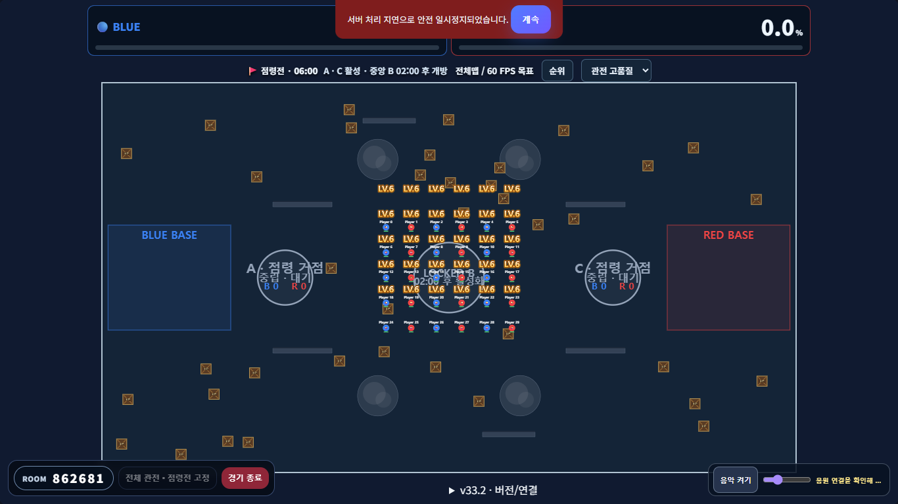
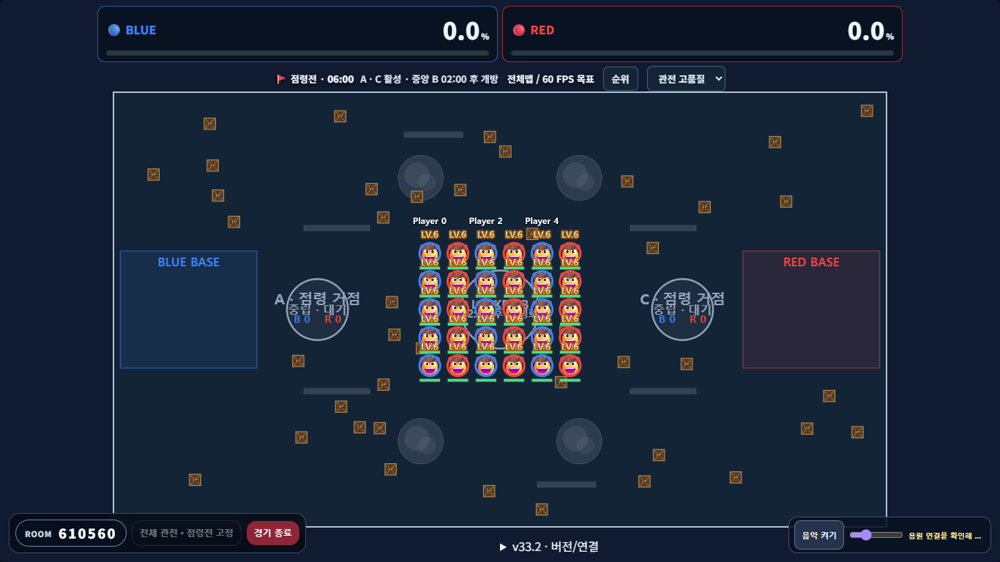
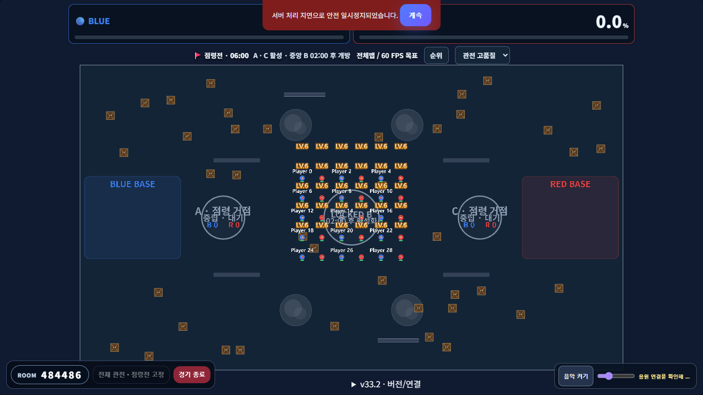
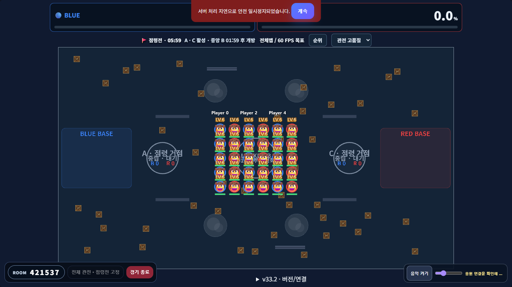

# Roster10 호스트 표시 및 지속 엔티티 검증

기준: `eb7c454f000223811fb17f99e2e22da01a220e81`. Windows Chromium 계열 headless, 로컬 실제 WebSocket 서버에서 수신한 상태를 고정 장면 fixture로 배치했다. 서버 전투 판정이나 학생 반경은 변경하지 않았다. 아래 결과는 표시 간격·자원 수명 검사이며 연속 전투 성능이나 실물 태블릿 검증을 대신하지 않는다.

## 변경

- 호스트 Canvas/Pixi는 `hostDisplayRadius`를 공유한다. 일반 화면 최소 지름 28 CSS px, 작은 화면 24 CSS px이며 실제 반경이 큰 캐릭터는 축소하지 않는다. 생존자 수/LOD를 반경 계산에 넣지 않아 모드 경계 자체에서 크기를 바꾸지 않는다.
- 이모지·레벨의 알파 경계를 한 번만 읽고 기존 크기 이하의 crop canvas를 캐시한다. 레벨의 실제 하단은 이모지 실제 상단에서 5px, 이름 하단은 레벨 상단에서 3px 떨어진다. HP는 같은 표시 반경 아래 4px이다. 기절은 옆칸, 실드와 둔화는 HP 아래에 그린다.
- 고정 폰트 이름/레벨을 스프라이트로 재사용한다. 혼잡하면 이름부터 생략해 다른 몸체·레벨·HP를 덮지 않도록 한다. 참가자 제거와 reset은 이름 텍스처·표시 참조를 정리한다.
- 조커 분신은 Participant 복제가 아닌 `shots`의 미끼 엔티티를 독립 렌더한다. 이름/이모지/HP를 그리고 은신한 소유자 위치를 잇지 않는다. 밧줄은 현재 소유자와 실제 머리/앵커를 잇고, 버섯은 준비/활성 상태, 독은 실제 위험 반경을 표시한다.
- 왕의 링은 서버 `dynamicWalls.rings`의 scoped ID별 고정 Graphics/Path2D를 재사용한다. 만료·삭제·reset·Canvas fallback에서 제거한다. 별도의 `ring-wall` shot을 중복 렌더하지 않는다.
- 신규 부캉이/꿀꿀이의 서버 `roster10Move` 표시와 활성 moveHaste가 함께 있을 때만 짧은 속도선을 표시한다. 기존 77종 moveHaste 표현은 유지한다. 판다의 다음 평타 충전은 고유 `pandaNextBasic` 상태의 초록 arc이며 서버 만료 후 사라진다.

## 실행 결과

| 검사 | 상태 | 시간 | 범위 |
|---|---|---:|---|
| `node --test tests/unit/host-layout.test.mjs` | PASS | 0.085초 | CSS 반경/정보 간격, 새 상태 표시와 만료, 기존 moveHaste 표시 불변 3개 |
| `node tests/roster10/host-readability.mjs` | PASS | 98.72초 | Canvas/Pixi × 3모드 × 4 viewport/DPR 조합 × 3품질 × 전체/집중 × 30/13/12/6/5/3/1명 = 1,008 장면; reset/cache 6개 |
| 기준 `host-comparison.mjs baseline` | MEASURED | 44.92초 | 동일 일반 몸체, Canvas/Pixi × 3모드 × 30/6/5명, 실제 알파 경계와 캡처 18개 |
| 후보 `host-comparison.mjs candidate` | PASS | 42.63초 | 위와 동일한 실제 Canvas draw 호출/Pixi sprite 알파 경계 18개 |
| 혼잡 이름 처리 후 `HOST_MODES=team-capture host-comparison.mjs candidate-final` | PASS | 22.03초 | 수정한 혼잡 경로 Canvas/Pixi 6장면, 반복 줌 생성 횟수, 지속 엔티티 5종 표시/정리 |
| 실제 Samsung/iPhone/iPad · 학교 Wi-Fi | NOT_RUN | — | 이번 고정 장면 검사에 실기기를 사용하지 않음 |

4가지 조합은 1366×768 DPR1, 1366×768 DPR2, 1920×1080 DPR1, 768×1024 DPR2이다. 첫 matrix 이후 발견한 혼잡 이름 겹침은 이름 생략으로 수정했고 관련 점령전 장면만 재실행했다. 표시 반경/글리프 간격/폰트는 변경하지 않았다. 스크린샷의 안전 일시정지 알림은 fixture가 서버 시뮬레이션을 정지시켜 고정 장면을 측정한 상태이며 부하 시험 결과가 아니다.

### 실제 CSS 픽셀 비교 (1366×768, 균형)

| 장면 | Canvas 이모지 지름 전→후 | Pixi 이모지 지름 전→후 | Canvas 레벨 간격 전→후 | Pixi 레벨 간격 전→후 |
|---|---:|---:|---:|---:|
| 30명 개인전 전체 | 15.54→28.00 | 13.96→28.00 | 26.28→5.00 | 52.19→5.00 |
| 6명 개인전 전체 | 28.21→35.57 | 28.21→35.57 | 53.07→5.00 | 54.81→5.00 |
| 5명 개인전 전체 | 33.90→42.75 | 33.90→42.75 | 64.24→5.00 | 65.94→5.00 |
| 30/6/5명 점령전 | 5.27→28.00 | 5.29→28.00 | 48.77→5.00 | 51.88→5.00 |

후보 이름과 레벨의 실제 간격은 양쪽 모두 3.00px. 밀집한 30명 점령전 비교 fixture에서는 이름 3개를 유지하고 나머지 이름을 생략하며 이모지/레벨/HP는 30개를 유지한다. 실제 인게임 캐릭터 크기를 변경한 결과가 아니라 같은 표시용 반경 20의 고정 비교 장면이다.

첫 가시 자산을 한 번 워밍업한 뒤 동일 줌 구간을 50프레임 반복했을 때 Canvas 생성 0, Pixi Texture 생성 0, Text 생성 0이다. 새로 보이는 이름을 처음 GPU로 올리는 비용과 매 프레임 재생성을 구분했다. 링은 같은 객체를 재사용했고 삭제/초기화 후 링 Map·표시 ID·`rw-` sprite 0, 소유 Graphics destroy 확인. 초기 matrix도 zoom 전후 자원 보유 수가 같고 reset 후 소유 texture source가 남지 않는 것을 확인했다.

개발 중 Chrome 실행 파일 경로 및 샌드박스 localhost 접속 제한은 INFRA_FAILURE였다. fixture의 빈 hostEffects 객체, 의도적으로 생략된 이름을 항상 그렸다고 가정한 검사, 최초 가시 이름 업로드를 반복 재생성으로 분류한 검사도 각각 실패했고 원인을 수정한 뒤 관련 검사를 실행했다. 이 실패를 기능 성공이나 실기기 PASS로 기록하지 않는다.

## 캡처

Canvas 기준 / 후보:

Pixi 기준 / 후보:

원시 수치는 `artifacts/roster10/host/report.json`, `host-candidate/report.json`, `host-candidate-final/report.json`에 생성된다. 기준 checkout의 `artifacts/roster10/host-baseline/report.json`에는 기준 측정이 있다. 실제 신규 스킬 ACTION·학생/상대/호스트 표시와 장시간 부하는 별도 Roster10 통합 시나리오 결과를 사용한다.
